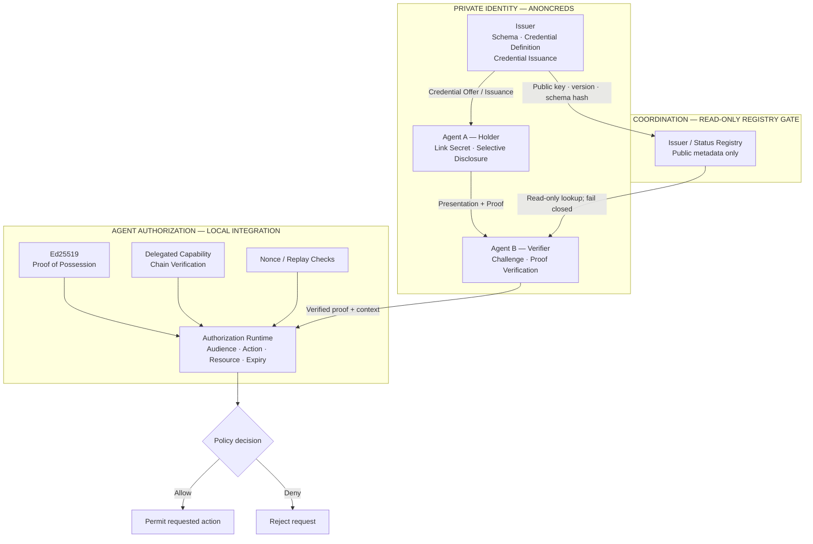
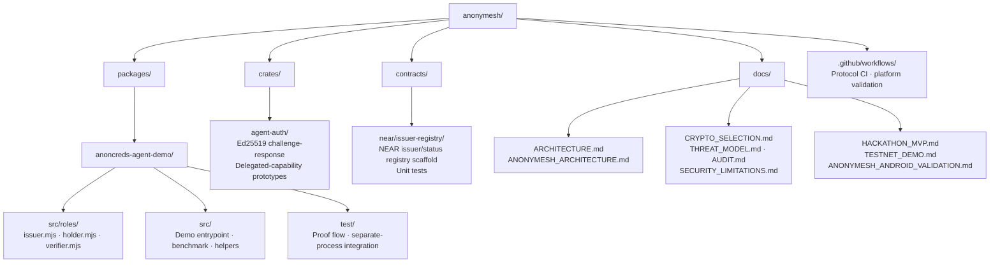

# ANONYMESH — Private Agentic Identity Infrastructure (PAII)

> **Project status (2026-11-16):** local Issuer–Holder–Verifier prototype and NEAR registry adapter are implemented with Linux CI evidence. The registry adapter has deterministic mock-RPC integration tests. **The NEAR Testnet contract is not deployed yet.** See [canonical project status and release gates](docs/PROJECT_STATUS.md) for exact evidence, architecture boundaries and the remaining live-Testnet steps.

**ANONYMESH** is a platform-independent protocol project exploring **Private Agentic Identity Infrastructure (PAII)**: privacy-preserving identity, trust and authorization for humans and autonomous AI agents.

**PAII is the innovation category proposed by this project**, not a claim that it is already an established industry standard or an official NEAR Hackathon track. ANONYMESH is the protocol and reference implementation being developed to explore this category.

The central idea is simple: **an agent should be able to prove that it is authorized to perform an action without unnecessarily revealing its private identity or its entire credential.**

## What is Private Agentic Identity Infrastructure?

PAII describes the infrastructure layer that allows people and AI agents to establish and prove trust, present limited credentials, delegate bounded authority and obtain authorization while minimizing disclosure of private information.

It is broader than a login mechanism or a standalone zero-knowledge proof. It brings together credential-based identity, privacy-preserving presentations, agent authentication, delegated capabilities, policy enforcement and trust coordination.

### Five innovation pillars

| Pillar | Purpose | ANONYMESH direction |
|---|---|---|
| **Private Identity** | Prove selected identity attributes without disclosing the full identity | Anonymous Credentials, selective disclosure and ZK proof systems |
| **Private Trust** | Let another agent verify relevant trust claims with limited disclosure | Verifiable credentials and future privacy-preserving reputation research |
| **Delegated Authority** | Allow an agent to delegate narrowly scoped permissions | Signed capability chains, attenuation and policy checks |
| **Private Agent Governance** | Control validity, revocation, replay and permitted actions | Revocation research, challenge binding, anti-replay and policy enforcement |
| **Agent Interoperability** | Let independently operated agents verify claims across system boundaries | Issuer–Holder–Verifier protocol and future NEAR registry integration |

These pillars are the project's design taxonomy and roadmap. They are not all implemented today; implementation status and limitations are listed below.

## Design principles

1. **Privacy by minimization:** disclose only the attributes needed for a verification decision.
2. **Verifiable authorization:** a valid identity proof alone must not be confused with permission to perform a requested action.
3. **Bounded delegation:** delegated authority should be limited by audience, action, resource, expiry and other applicable policy constraints.
4. **Separation of roles:** issuer, holder and verifier should have distinct responsibilities and, for stronger deployments, separate security domains.
5. **Honest security claims:** distinguish demonstrated properties from prototypes, planned work and unresolved risks.
6. **Platform independence:** the protocol is not tied to Android, a particular operating system or one agent framework.

## Protocol architecture

The core protocol uses three roles:

- **Issuer** creates schemas, credential definitions and credentials under an issuer policy.
- **Holder (Agent A)** protects its link secret and creates presentations that disclose only requested claims or prove predicates.
- **Verifier (Agent B)** issues a context-bound challenge and verifies a presentation against the request it originally created.

The intended authorization flow is:

1. An agent receives a credential from an issuer.
2. A relying agent requests proof of a specific claim or predicate, bound to its audience and a fresh challenge.
3. The holder creates a selective-disclosure proof.
4. The verifier validates the proof and the request context.
5. A separate authorization policy evaluates whether the verified claims and delegated capabilities permit the requested action.
6. The action is allowed only if all required checks pass.

A credential proof is **not by itself proof that a particular action is authorized**. The authorization and policy-enforcement layer is a distinct part of the design and remains under development.

## ZK proof requirement and implementation boundary

**Zero-knowledge proof is a core ANONYMESH requirement.** The current executable proof engine is Hyperledger AnonCreds CL presentations: the holder proves credential validity and requested predicates while selectively disclosing only the claims the verifier requested. The holder's link secret and hidden subject attributes stay holder-side. This is a credential-based zero-knowledge presentation, not a claim that ANONYMESH already implements a general-purpose zk-SNARK, zk-STARK, or on-chain proof verifier.

The Ed25519 proof-of-possession is a separate signature check that binds the request to the credential-bound agent key; it is **not itself a zero-knowledge proof**. Likewise, a valid AnonCreds proof does not automatically grant permission: the verifier must separately enforce issuer trust, challenge freshness, capability scope, expiry, replay protection and quota. The current implemented subject is an agent demo; human credential issuance, privacy-preserving revocation and unlinkable presentations remain incomplete.

## Integrated local authorization demo (prototype; not production)

The local three-process demo now connects AnonCreds verification, issuer-attested agent-key binding, Ed25519 proof-of-possession, a signed capability, verifier challenge binding, replay checks and quota consumption. This is an executable integration prototype, **not a production-ready authorization service**.

```text
Issuer
  |  issues a credential bound to the agent's public key
  v
Agent A — Holder
  |  AnonCreds presentation
  |  + Ed25519 proof of possession
  |  + delegated capability chain
  v
Agent B — Verifier
  |  checks credential proof, agent public-key binding,
  |  capability chain and fresh challenge
  v
Authorization Runtime
  |  checks audience, task, resource, expiry, replay,
  |  delegation limits and quota
  v
VALID -> permit the requested action
REJECTED -> deny the action
```

### What each step must prove

1. **Issuer:** issues a credential whose agent-key binding is covered by the credential signature. The credential must not merely contain an unverified display name or free-form subject marker.
2. **Agent A — Holder:** creates an AnonCreds proof for the minimum required claims, proves possession of the private key corresponding to the credential-bound public key, and presents the delegated capability chain. The holder's link secret and private identity attributes remain local.
3. **Agent B — Verifier:** verifies the AnonCreds presentation against its own request, checks that the public key disclosed/proven by the credential is the same key used for Ed25519 proof-of-possession and the capability delegate, and validates the challenge's audience, task and freshness.
4. **Authorization Runtime:** independently enforces capability scope, resource, expiry, delegation attenuation, replay protection and quota immediately before the action. A valid credential alone must never authorize an action.
5. **Decision:** return only the minimum decision information needed by the relying agent. Deny by default if any required proof, trust state or policy check fails.

### Pairwise keys and correlation limits

The design uses a **different agent key for each verifier audience** where the deployment supports it. This reduces the ability to correlate an agent across different verifier domains because the public key shown to one audience is not reused with another.

This does **not** guarantee complete unlinkability:

- The same pairwise public key can link multiple sessions within the same audience.
- Disclosed attributes, timestamps, network metadata, issuer records and verifier logs may still enable correlation.
- Colluding verifiers may combine information they independently observe.

ANONYMESH therefore does not claim full unlinkability or resistance to all verifier collusion. Pairwise keys are a correlation-reduction measure, not a substitute for randomized presentations, disclosure minimization, metadata protections and empirical cross-verifier privacy testing.

### Implementation status of this flow

The local HTTP integration now carries the issuer-created capability and holder proof into the verifier's unified gate. The verifier checks the AnonCreds presentation, checks that the revealed credential key matches the capability delegate, validates the Ed25519 request proof and capability chain, then consumes nonce and quota state. The demo returns an authorization decision; it does not execute a real external action. It uses one issuer-created root capability rather than demonstrating multi-agent delegation across separate network trust domains. The HTTP services are loopback-only test harnesses, not production endpoints.

## Current implementation status

ANONYMESH is a platform-independent protocol and agent-identity architecture. The runnable local demo is implemented as three separate Node.js processes in `packages/anoncreds-agent-demo`. The unified verifier checks AnonCreds, credential-to-key binding, Ed25519 proof-of-possession and a signed delegated-capability chain before consuming nonce/quota state. The process integration test exercises invalid challenge binding, forged proof rejection, successful authorization, replay rejection and scope rejection. Revocation, distributed replay protection, unlinkability analysis and independent cryptographic review remain pending.

### Separate-process demo

The demo package provides three processes:

- **Issuer** creates the schema, credential definition and offer, and retains the credential-definition private key in its own process memory.
- **Holder (Agent A)** creates and retains its link secret, creates the blinded credential request, processes the issued credential and generates selective-disclosure presentations.
- **Verifier (Agent B)** owns the challenge ledger, retains the original presentation request, verifies the proof against that request, and consumes the nonce only after successful verification.

All role servers bind to loopback by default. The HTTP endpoints are a local integration harness, not an authenticated production network protocol. The issuer and verifier share only public schema/credential-definition data. The holder's link secret and private subject are not returned by its endpoints.

Start each role in its own terminal, using the same package directory:

```sh
npm run start:issuer --prefix packages/anoncreds-agent-demo
ISSUER_URL=http://127.0.0.1:4311 npm run start:holder --prefix packages/anoncreds-agent-demo
ISSUER_URL=http://127.0.0.1:4311 npm run start:verifier --prefix packages/anoncreds-agent-demo
```

For a reproducible full flow, run `npm test --prefix packages/anoncreds-agent-demo`. The integration test launches the three roles as separate operating-system processes, enrolls Agent A, requests a challenge from Agent B, submits tampered proofs first, then submits the authentic proof and finally replays it. It then restarts the verifier with the same SQLite files and replays the consumed challenge again. Expected results: tampered proofs rejected without consuming the challenge; authentic proof accepted once; replay rejected both before and after verifier restart.

### Security behavior and limitations

The verifier checks the stored challenge and original presentation request, then validates AnonCreds, the revealed key binding, capability signature/scope and Ed25519 proof before consuming authorization quota. Failed checks do not consume the challenge or quota. The verifier persists challenge scope, resource, original presentation request and consumed state in SQLite by default at `~/.local/state/anonymesh/challenges.sqlite`; set `CHALLENGE_DB` to choose another file. The authorization store separately persists consumed nonce records and capability quota at `~/.local/state/anonymesh/authorization.sqlite`; set `AUTHORIZATION_DB` to choose another file. The process integration test restarts the verifier using the same database files and confirms that a previously consumed challenge is still rejected as consumed. SQLite uses WAL, synchronous FULL and a 5-second busy timeout. Challenge lifetime is capped at 300 seconds; expired challenge rows are pruned on issuance and pending challenges are capped at 10,000 per shared ledger. A process integration test also starts two verifier processes against the same local SQLite files and races one fresh challenge; CI verifies exactly one authorization succeeds and the other is denied. This is evidence for same-host shared-file concurrency only, not a distributed database or cross-host production deployment. Authenticated transport, TLS, rate limits, key rotation and operational monitoring are still required.

Agent A reveals only `agent_role`; the private subject and `valid_until` remain hidden, with validity enforced by an AnonCreds predicate. This is not a claim of absolute unlinkability or a full privacy-preserving revocation system.

### Reproduction and benchmarks

- `npm test --prefix packages/anoncreds-agent-demo`
- `npm run demo --prefix packages/anoncreds-agent-demo` (legacy single-process proof smoke test)
- `npm run benchmark --prefix packages/anoncreds-agent-demo`

The current Node implementation has passing Linux CI evidence for the proof flow and separate-process integration; use the linked workflow runs and current branch CI as the source of truth rather than relying on a hard-coded historical test count. The registry-backed process test uses `NEAR_REQUIRED=true`, a persisted issuer key, and a deterministic local JSON-RPC mock. The standalone smoke demo reports `valid: true`, `privateSubjectDisclosed: false`, and `nonceBoundToContext: true`. Benchmark values are host-specific, include native allocations, and are not Android/Bionic results or a benchmark of the user's phone.

Platform-specific smoke tests are documented separately from the protocol architecture. They validate selected library bindings on target devices and are not required to understand or run the platform-independent protocol demo. A physical Android 15 native-proof smoke test was reported successful on 15 November 2026: `PROOF VERIFIED`, role `weather_reader` disclosed, private subject not disclosed, and proof JSON length 18,117 characters (AnonCreds wrapper 0.5.0). This is a single-process local proof demonstration, not full Android Issuer–Holder–Verifier integration or Android performance evidence.

## Roadmap

The following roadmap defines the intended development direction. A roadmap item is not a claim of completion.

1. **Private Agent Identity:** strengthen credential issuance, holder protection and selective-disclosure verification.
2. **Private Agent Authorization:** bind proof requests to audience, task and fresh challenges; integrate capability verification with actual policy decisions.
3. **Private Agent Trust:** research privacy-preserving reputation and cross-agent trust verification without introducing unnecessary correlation.
4. **Private Agent Governance:** develop privacy-aware revocation, durable anti-replay, rate limits and enforceable policy controls.
5. **Private Agent Economy:** enable interoperable verification and bounded delegation between independently operated agents, with NEAR used where on-chain coordination adds value.

## NEAR integration

NEAR is a public-registry layer for issuer metadata and opaque status commitments. The Node verifier has a mandatory registry-backed mode when `NEAR_REQUIRED=true`; it reads the registry through a bounded, read-only RPC adapter and fails closed on invalid or unavailable records. Private identity attributes, holder secrets, proof witnesses and private credential contents must not be placed on-chain. The contract is not deployed and does not provide on-chain AnonCreds or revocation-proof verification.

For a judge-facing, step-by-step explanation of the NEAR contract, RPC request, verifier gate, reproducible local checks, and missing live-Testnet evidence, see [NEAR Judge Guide](docs/NEAR_JUDGE_GUIDE.md).

## Other components and status at a glance

Delegated capability verification and the NEAR issuer/status registry are integrated local/preflight components. NEAR Testnet deployment and end-to-end validation are the next implementation stage. Unlinkable presentations, privacy-preserving revocation, human identity issuance, local-first agent runtime, and production-grade rate limits remain incomplete. The project owner reports that the hackathon form and public X demo post were submitted before the deadline; this repository audit does not independently verify the form receipt. NEAR Testnet deployment has not yet been completed.

| Component | Current status |
|---|---|
| AnonCreds issuer-holder-verifier demo | Implemented as separate local Node processes; Linux CI tests pass |
| Selective disclosure / hidden expiry predicate | Implemented and exercised in the Node.js demo |
| Ed25519 proof-of-possession | Integrated into local verifier decision path; ordinary key-based authentication, not anonymous |
| Delegated capability + PoP | Integrated into the local verifier decision path; one root capability in demo, not production delegation |
| NEAR issuer/status registry | Contract plus strict Node read adapter and mocked-RPC verifier integration; not deployed |
| Unlinkable presentations | Not demonstrated |
| Privacy-preserving revocation | Not implemented |
| Local-first agent runtime and durable wallet | Not implemented |
| Production rate limits and distributed replay protection | Not implemented |

## Architecture overview

ANONYMESH separates credential issuance, private presentation, verification, authorization policy and public registry coordination. The diagram shows the runnable local Issuer–Holder–Verifier flow and the optional mandatory registry gate used when `NEAR_REQUIRED=true`.



**Current boundaries**

- **Runnable demo:** separate local Node.js Issuer, Holder and Verifier processes in `packages/anoncreds-agent-demo`; Linux CI exercises proof verification and nonce replay behavior.
- **Authorization:** the local verifier path checks the credential-bound issuer key, agent key proof-of-possession, capability chain, challenge binding, replay and quota. Production tool enforcement remains out of scope.
- **NEAR:** the issuer/status registry is consumed through a strict read-only adapter in required mode, but the contract is not deployed and live testnet evidence is absent.
- **Not claimed:** complete unlinkability, production authorization runtime, privacy-preserving revocation or production readiness.

### Repository structure

The repository is organized by implementation boundary: the Node.js AnonCreds demo, Rust agent-auth prototypes, NEAR registry scaffold, documentation and CI workflows.



`packages/anoncreds-agent-demo` is the current runnable multi-process demonstration. `crates/agent-auth` and `contracts/near/issuer-registry` contain prototype components; their presence in the tree does not imply a production deployment.

For implementation-facing boundaries, read [Architecture](docs/ARCHITECTURE.md). For the full protocol design, actors, credential lifecycle, trust boundaries, security controls, acceptance criteria and release gates, read [ANONYMESH Protocol Architecture](docs/ANONYMESH_ARCHITECTURE.md). The safe testnet procedure is in [TESTNET_DEMO.md](docs/TESTNET_DEMO.md), and unsupported security guarantees are listed in [SECURITY_LIMITATIONS.md](docs/SECURITY_LIMITATIONS.md).
