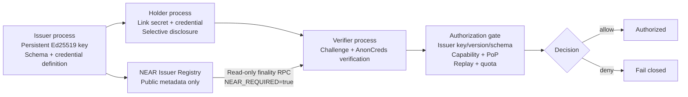

# ANONYMESH Final Integration Report

**Repository:** `wadezigh96/anonymesh`
**Branch:** `feat/anonymesh-private-agent-identity`
**CI-tested baseline commit:** `87e1f0bf6c96eea5c7c182ec335f395ee9dbf291`
**Remote hardening commit integrated:** `5b880f4` (streaming RPC limits, transient-only stale fallback, regression tests)
**Current local merge commit:** `fd3873c`
**Network boundary:** NEAR testnet only; no mainnet action.

## Executive summary

The Node issuer-holder-verifier flow, persistent issuer key lifecycle, credential-bound registry key, read-only NEAR registry adapter, capability/proof-of-possession authorization, replay/quota state, and fail-closed registry gate are implemented and tested. Additional hardening now bounds streamed RPC bodies, cancels oversized responses, and permits stale-cache fallback only for transient availability failures. The baseline implementation workflows passed; the hardening merge requires a fresh CI run before it can be treated as CI-verified.

A live NEAR testnet deployment is **BLOCKED**, not complete: no authorized funded testnet deployer, contract account, signer, approved transaction payload, or live registry configuration was available in this execution context. No deployment or transaction was attempted, and no fabricated account, RPC response, transaction hash, or checksum is reported.

## Canonical architecture and data flow



When `NEAR_REQUIRED=true`, the verifier reads `get_issuer` through the bounded RPC adapter before authorization. The credential reveals `issuer_registry_key`; the verifier compares it with the active registry record, then checks key version, schema hash, capability chain, agent proof-of-possession, challenge, replay and quota. The registry's `status_root` is opaque and is not a revocation proof.

## Status matrix

| Area | Status | Evidence / limitation |
|---|---|---|
| Node issuer-holder-verifier flow | **PASS** | Local suite 86/86; baseline Node and process workflows passed. Fresh CI for hardening merge remains required. |
| Persistent issuer key | **PASS** | Versioned JWK file, strict permissions, rotation/version tests. |
| Registry key conversion and RPC validation | **PASS** | Canonical NEAR key tests, streamed size enforcement, malformed/timeout/cache tests, mocked-RPC process flow. Fresh CI for hardening merge remains required. |
| Registry-backed authorization gate | **PASS** | Required mode rejects unknown, inactive, mismatched, stale and unavailable records. |
| Capability, PoP, replay and quota | **PASS** | Integrated verifier path plus restart/concurrency tests. |
| Rust agent-auth | **PASS** | [Workflow 43734220180](https://github.com/wadezigh96/anonymesh/actions/runs/43734220180). |
| NEAR contract tests/WASM | **PASS** | [Workflow 43734232625](https://github.com/wadezigh96/anonymesh/actions/runs/43734232625); no deployment. |
| Android release build | **PASS** | [Workflow 43734226260](https://github.com/wadezigh96/anonymesh/actions/runs/43734226260); single-process smoke test only. |
| Linux ARM64 benchmark | **PASS** | [Workflow 43734056425](https://github.com/wadezigh96/anonymesh/actions/runs/43734056425). |
| Live NEAR testnet deployment | **BLOCKED** | Requires signer, funded deployer, contract account, approved payload, and live RPC configuration. |
| Live registry verifier smoke test | **BLOCKED** | Depends on successful approved deployment and registered issuer record. |
| Privacy-preserving revocation | **NOT IMPLEMENTED** | Status root is an opaque commitment; no witness/accumulator verification. |
| Production TLS, distributed replay, tool sandbox, durable Android wallet | **NOT IMPLEMENTED** | Explicit production limitations remain. |

## Contract interface

The contract stores public issuer metadata only:

- explicit owner;
- issuer account ID;
- canonical `ed25519:<Base58>` public key;
- monotonically increasing key version;
- schema hash;
- active/inactive status;
- monotonically increasing status epoch;
- opaque status root.

The relevant methods are `register_issuer`, `set_issuer_active`, `update_status_root`, `get_issuer`, and `get_owner`. Mutations are owner-controlled. Unknown issuers are handled without authorization. The contract does not verify AnonCreds proofs, BBS/ZK proofs, revocation witnesses, or non-revocation proofs.

## Environment configuration

For a real testnet verifier deployment, configure values from approved infrastructure only:

```env
NEAR_REQUIRED=true
NEAR_NETWORK=testnet
NEAR_REGISTRY_CONTRACT=<approved-registry-contract-account>
NEAR_RPC_URL=<approved-near-testnet-rpc>
NEAR_ISSUER_ACCOUNT_ID=<registered-issuer-account>
NEAR_EXPECTED_KEY_VERSION=<positive-version>
NEAR_EXPECTED_SCHEMA_HASH=<64-lowercase-hex-schema-hash>
NEAR_EXPECTED_STATUS_EPOCH=<minimum-epoch>
NEAR_CACHE_TTL_MS=0
NEAR_MAX_STALE_AGE_MS=0
ISSUER_KEY_FILE=<owner-only-0600-secret-path>
```

Do not place real values, private keys, tokens or seed phrases in Git, logs or this report.

## Exact verification evidence

Final implementation workflows:

- Node integration: [43734056349](https://github.com/wadezigh96/anonymesh/actions/runs/43734056349)
- Process integration: [43734056402](https://github.com/wadezigh96/anonymesh/actions/runs/43734056402)
- ARM64 benchmark: [43734056425](https://github.com/wadezigh96/anonymesh/actions/runs/43734056425)
- Rust agent-auth: [43734220180](https://github.com/wadezigh96/anonymesh/actions/runs/43734220180)
- Android release APK: [43734226260](https://github.com/wadezigh96/anonymesh/actions/runs/43734226260)
- NEAR contract/WASM: [43734232625](https://github.com/wadezigh96/anonymesh/actions/runs/43734232625)

Local Node evidence:

```sh
cd packages/anoncreds-agent-demo
npm test                         # 86 passed, 0 failed
npm run demo                     # valid: true; privateSubjectDisclosed: false
npm run benchmark                # host-specific Linux x64 benchmark
node --test test/process-integration.test.mjs
```

The 86-test result is local evidence for merge commit `fd3873c`; the six GitHub workflows linked above ran on the earlier baseline and must be rerun after this hardening merge.

The exact WASM checksum and testnet contract account are **BLOCKED** until a final workflow artifact is retained and an approved testnet deployment exists. No checksum or account is invented here.

## Deployment gate and remaining prerequisites

Before any deployment, obtain all of the following:

1. An explicitly approved NEAR testnet network and RPC endpoint.
2. An authorized deployer signer available through the approved secret mechanism.
3. A funded deployer account and designated contract account.
4. Contract WASM artifact from the final pinned build plus independently computed SHA-256.
5. Reviewed initialization arguments, storage deposit, gas, owner account, and emergency recovery plan.
6. Approval for each mutation transaction.
7. Live `get_owner` and `get_issuer` verification after deployment.
8. A real verifier run against the live registry, including valid, inactive, key mismatch, and RPC failure cases.

Until these prerequisites exist, the correct final status is **CI-verified and deployment-blocked**, not testnet-deployed.
